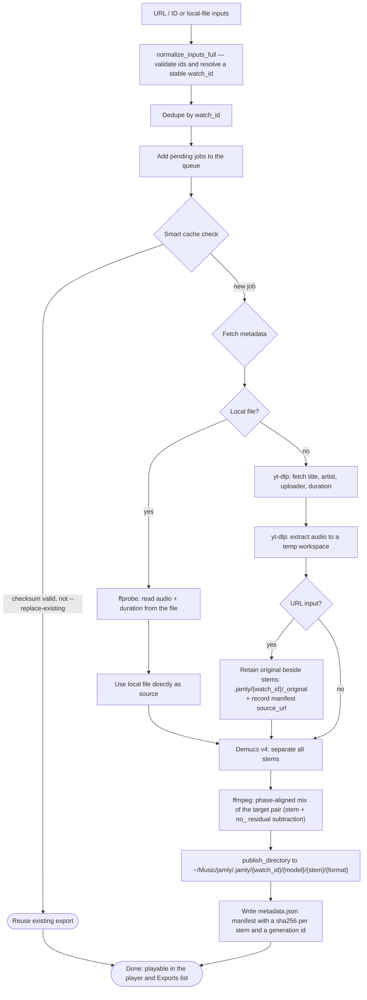

# Processing Pipeline

Every input flows through the same local pipeline, whether it comes from the companion UI, the CLI, or the browser extension. See [README.md](README.md) for an overview and [DESIGN.md](DESIGN.md) for architecture details.

## Pipeline stages

- **Input normalization**: URLs, bare IDs, and local file paths are all resolved to a stable `watch_id`; duplicate sources are dropped.
- **Smart cache**: when an export's checksum already matches the manifest and `--replace-existing` is not passed, the job is skipped and reused without re-downloading or re-separating.
- **Metadata**: `yt-dlp` handles URLs/IDs; `ffprobe` reads local files directly.
- **Original retained**: for URL inputs, the extracted audio is copied next to the stems (named with an `_original` suffix) so it can be replayed as "Original" even offline; local-file inputs keep their own source path.
- **Separation & mix**: Demucs v4 separates all stems, then `ffmpeg` builds the requested pair (`drums`/`no_drums`, or vocals/bass/guitar/piano and their residuals) with phase-aligned subtraction.
