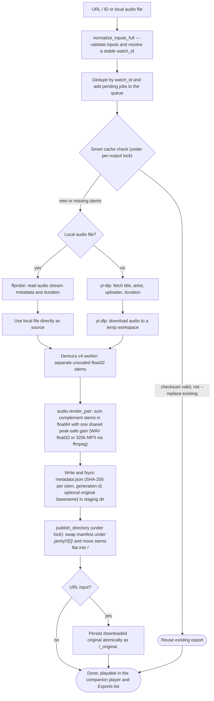

# Processing Pipeline

Every input flows through the same local pipeline, whether it comes from the companion UI, the CLI, or the browser extension. See [README.md](README.md) for an overview and [DESIGN.md](DESIGN.md) for architecture details.

## Pipeline stages

- **Input normalization**: URLs, YouTube IDs, and supported local audio file paths are resolved to a stable `watch_id`; unsupported local file extensions and duplicates are rejected/deduped.
- **Smart cache**: when an existing manifest matches the processing version, identity, model, stem mode, format, and SHA-256 checksums (and `--replace-existing` is not set), the job is skipped and reused without re-downloading or re-separating. Missing stem files are regenerated automatically.
- **Metadata & download**: `yt-dlp` handles remote URLs/IDs; `ffprobe` probes local audio files directly with no network access.
- **Separation & mix**: Demucs v4 separates all model stems (4 or 6) as unscaled float32 WAVs. `audio.render_pair` validates matching length/rate/channels, sums all non-target stems in float64 for pair modes (or keeps all individual stems for `--stem all`), applies one shared clipping-safe gain, and encodes to float32 WAV or 320 kbps MP3 via `ffmpeg` (with a 4x-oversampled -1 dBFS decoded peak check).
- **Atomic publish & retained original**: `metadata.json` is written and fsynced in a sibling staging directory before `publish_directory` swaps the manifest under `<output>/.jamly/` and moves exported stems flat into `<output>/` (`[all]` is tagged for `--stem all` exports so stem pairs are never overwritten). For URL inputs, the downloaded original is then atomically persisted as `<output>/<prefix>_original.<ext>` and recorded as a relocatable basename in `manifest["original"]` while keeping canonical `source_url` intact.
